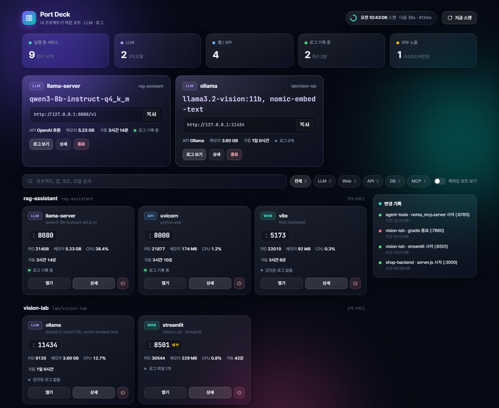
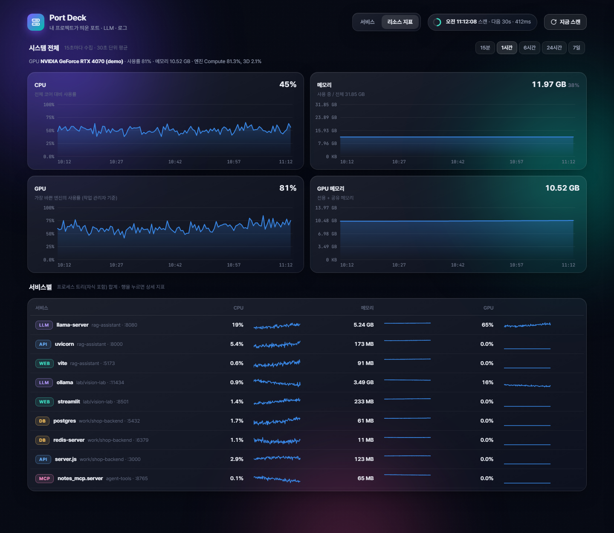
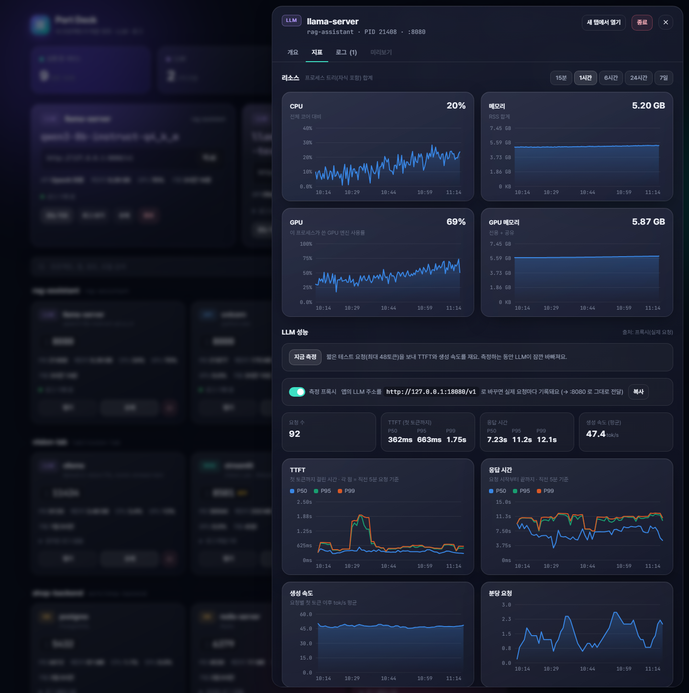
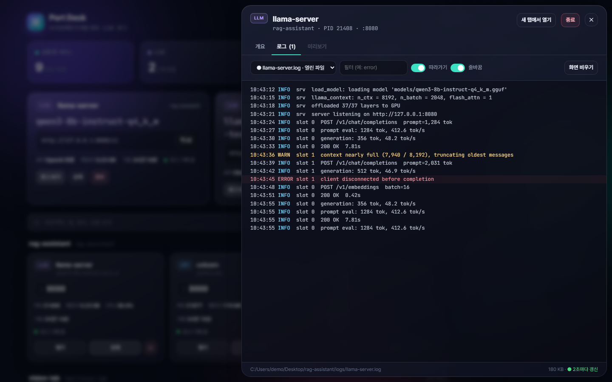

# Port Deck

내 프로젝트가 띄운 **포트 · LLM · 로그**를 한눈에 보는 로컬 대시보드.
시스템 서비스나 설치된 앱은 빼고, 프로젝트 폴더에서 실행된 프로세스만 보여줍니다.









> 스크린샷은 샘플 데이터로 띄운 데모 모드(`python server.py --demo`)입니다.

## 기능
- **포트 목록**: 프로젝트별로 묶어서 앱 이름, 포트, PID, 메모리, CPU, 가동 시간 표시
- **종류 자동 분류**: LLM / Web / API / DB / MCP / TCP
- **LLM 감지**: 모델 파일(`.gguf`, `.litertlm`, `.safetensors` 등)과 `/v1/models`(OpenAI 호환), `/api/tags`(Ollama) 응답으로 모델 이름과 엔드포인트 확인
- **로그 보기**: 프로세스가 열어 둔 로그 파일과 프로젝트 폴더의 관련 `.log`를 찾아 2초마다 이어서 표시 (필터, 에러/경고 색상)
- **웹 미리보기**: 로컬 웹앱을 대시보드 안에서 바로 확인 (임베드를 막는 앱은 새 탭으로)
- **프로세스 종료**: 확인 창에서 자식 프로세스까지 보여준 뒤 종료
- **외부 노출 경고**: `0.0.0.0`으로 열린 포트 표시
- 스캔은 백그라운드에서 60초마다, `지금 스캔` 버튼으로 즉시 실행
- **리소스 지표 (Prometheus 스타일)**: 시스템 전체와 서비스별(자식 프로세스 포함) CPU · 메모리 · GPU · GPU 메모리를 15초마다 SQLite에 기록하고 15분~7일 범위로 차트 표시
- **GPU**: Windows 성능 카운터로 제조사(NVIDIA/AMD/Intel) 상관없이 프로세스별 사용률 측정, `nvidia-smi`가 있으면 VRAM 정보 보강
- **LLM 성능 지표**: TTFT · 응답 시간의 P50/P95/P99, 생성 속도(tok/s), 분당 요청 수
- **Prometheus 연동**: `http://127.0.0.1:7070/metrics` 를 Prometheus/Grafana에서 그대로 수집 가능

## LLM 지표는 어떻게 모으나요?
LLM 서버마다 제공하는 정보가 달라서 세 가지 방법을 씁니다. 상세 화면의 **지표** 탭에서 고를 수 있어요.

| 방법 | 설명 | 적합한 경우 |
|---|---|---|
| **/metrics 자동 수집** | LLM 서버가 Prometheus 지표를 내주면 히스토그램에서 P50/P95/P99 계산 | vLLM · SGLang · TGI (기본 제공), llama.cpp (`--metrics`) |
| **측정 프록시** | 대시보드가 측정용 포트(예: `:19379`)를 열고 LLM에 그대로 전달하면서 요청마다 TTFT · 응답 시간 · 토큰 기록. 앱의 LLM 주소만 프록시 포트로 바꾸면 됨 | 지표를 제공하지 않는 서버 (litert-lm, Ollama 등)의 **실제 트래픽** |
| **지금 측정** | 짧은 테스트 요청(최대 48토큰)을 보내 측정. `llm_probe_interval_min`으로 주기 실행 가능 | 빠른 확인, 트래픽이 없을 때 |

- 그래프의 각 점은 직전 5분(범위가 길면 더 길게) 요청으로 계산한 이동 창 분위수입니다. Prometheus의 `histogram_quantile(rate[5m])`와 같은 개념이에요.
- TTFT와 생성 속도는 **스트리밍 요청**에서만 잴 수 있고, 비스트리밍 요청은 응답 시간만 기록됩니다.

## 실행
Python 3.8+ 필요.

```bat
start.bat
```
또는
```bash
pip install -r requirements.txt
python server.py
```
→ http://127.0.0.1:7070

Mac은 포트 목록을 읽으려면 `sudo`가 필요합니다.

샘플 데이터로 화면만 먼저 보고 싶다면:
```bash
python server.py --demo
```

상세 화면 바로 열기 링크: `http://127.0.0.1:7070/#open=<PID>&tab=logs` (`tab`: `overview` / `logs` / `preview`)

## 설정 (`config.json`)
| 키 | 설명 |
|---|---|
| `port` | 대시보드 포트 (기본 7070) |
| `scan_interval_sec` | 스캔 주기 (기본 60초) |
| `project_roots` | 이 폴더 아래에서 실행된 프로세스만 "내 프로젝트"로 봄. `D:\work` 같은 경로를 추가하세요 |
| `exclude_paths` | 프로젝트에서 제외할 경로 (`Program Files`, `AppData` 등) |
| `exclude_process_names` | 항상 제외할 프로세스 이름 (에디터, 브라우저 등) |
| `metrics_interval_sec` | 리소스 지표 수집 주기 (기본 15초) |
| `metrics_retention_days` | 지표 보관 기간 (기본 7일, `data/metrics.db`) |
| `llm_probe_interval_min` | LLM 자동 테스트 측정 주기 (분). `0`이면 끔 (기본) |

## 로그가 안 보일 때
다른 프로그램의 **콘솔 출력은 외부에서 읽을 수 없습니다.** 로그를 보려면 파일로 남기도록 실행하세요.
```bat
python app.py > app.out.log 2>&1
```

## 보안
- `127.0.0.1`에만 열리고, Host 헤더를 검사해 DNS 리바인딩을 막습니다.
- 모든 API는 실행할 때마다 새로 만들어지는 토큰 헤더가 필요합니다 (다른 사이트에서의 요청 차단).
- 종료는 대시보드에 표시된 프로젝트 프로세스만, 스캔 시점의 PID와 시작 시각이 일치할 때만 허용됩니다.
- 원격 접속용이 아닙니다. `host`를 `0.0.0.0`으로 바꾸면 같은 네트워크의 누구나 프로세스를 종료할 수 있게 되니 바꾸지 마세요.
